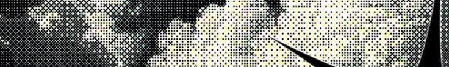
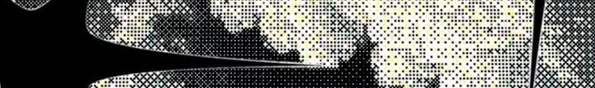
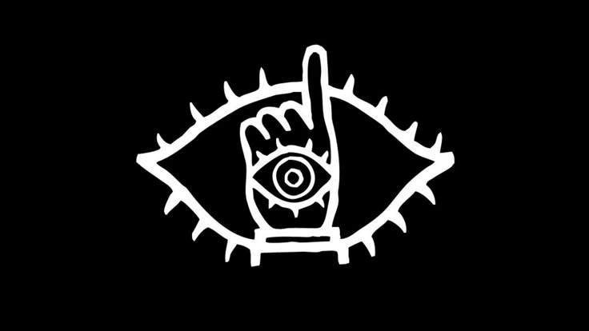
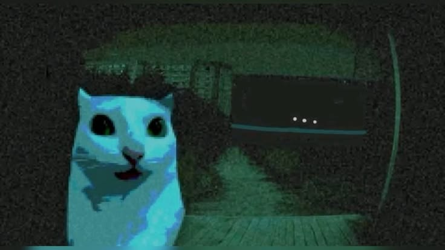

 

## 🧑‍💻 About me

- 🎓 1st-year **Computer Engineering** student at the **Instituto Tecnológico de Costa Rica (TEC)**
- 🛰️ Took part in the **NASA Space Apps Challenge** with [AguaAlerta](https://github.com/Jyin28/Hefesto)
- 🔌 I like projects where hardware and software meet: microcontrollers, sensors and the code that talks to them
- 🧠 Working mostly with **Python**, **C#**, **TypeScript** and **Java** on team projects
- 🚧 Currently building **ConviTEC**, a distributed inventory system with **RabbitMQ** and Dijkstra delivery routes
- 📫 Reach me at **memmared2017@gmail.com**

 

## 🛠️ Tech stack

**Languages**

**Web & backend**

**Hardware & tools**

**Also used**

## 🚀 Featured projects

<table>
<tr>
<td width="50%" valign="top">

### 🛰️ [AguaAlerta](https://github.com/Jyin28/Hefesto)
**NASA Space Apps Challenge**

Educational website that shows how temperature and rainfall have changed in Costa Rica, using NASA POWER, Copernicus ERA5-Land and national streamflow data. Interactive maps, a forecasts page and a Telegram newsletter.

**My part:** forecasting engine and API, Copernicus CDS data pipeline, Telegram bot, ES/EN website.

[🌐 Live site](https://v0-agualerta.vercel.app) · [▶️ Video](https://youtu.be/49YRnnPCppY)

</td>
<td width="50%" valign="top">

### 👶 [Cuna Inteligente IoT](https://github.com/Jyin28/ProyectoModelado)
**Smart crib for a client**

Monitoring and assistance system for babies: temperature, humidity and motion sensors, an adjustable lamp and LED figures, a web dashboard and Telegram alerts, all driven by a Raspberry Pi Pico 2 W.

**My part:** requirements, Jira backlog and integrating the web base.

</td>
</tr>
<tr>
<td width="50%" valign="top">

### 🎲 [Distributed Monopoly](https://github.com/5amz/Monopoly)
**Algorithms & Data Structures I**

Video-game-themed Monopoly with a client-server architecture over TCP sockets, hand-built linear data structures, and a physical module with RFID cards and an electronic die (Arduino Uno / Raspberry Pi Pico 2 W).

**My part:** desktop client (Windows Forms), TCP protocol and GUI.

</td>
<td width="50%" valign="top">

### 🏪 ConviTEC &nbsp;`🚧 coming soon`
**Algorithms & Data Structures I · Project 2**

Distributed inventory and ordering system for a chain of four convenience stores. Branches sync stock through RabbitMQ, deliveries are routed with Dijkstra over a weighted graph of Costa Rica, and every data structure is built from scratch.

</td>
</tr>
</table>

<b>📂 Other repos</b>

 

| Repo | What it is | Stack |
| --- | --- | --- |
| [proyectointro](https://github.com/Emanuel17138/proyectointro) | *Coffin*, a game with images and sound | Python, Tkinter |
| [proyectointro2](https://github.com/Emanuel17138/proyectointro2) | 2D game | Python, Pygame |
| [proyectofunda](https://github.com/Emanuel17138/proyectofunda) | Raspberry Pi Pico talking to a PC app over sockets | MicroPython, Tkinter |
| [tareaintro](https://github.com/Emanuel17138/tareaintro) | Calculator | Java |

## 📊 GitHub stats

 

## 📫 Contact

<i>me checking my notifications</i>

  

<!-- LinkedIn: replace YOUR-LINKEDIN below with your profile URL slug -->

